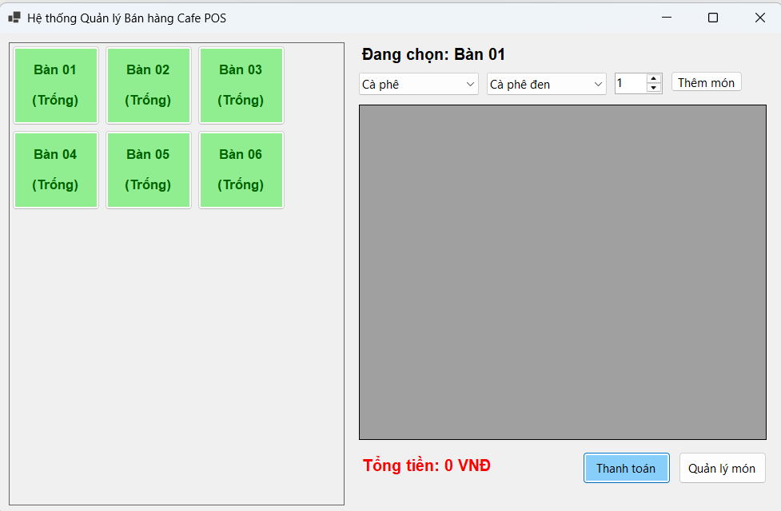
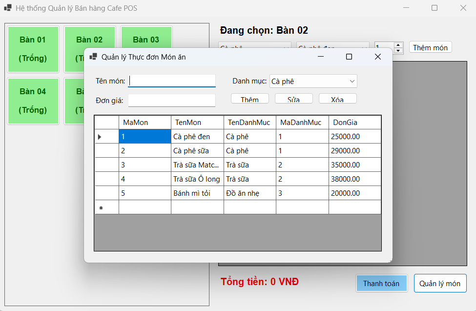
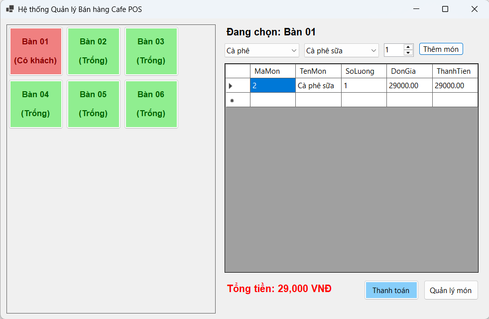
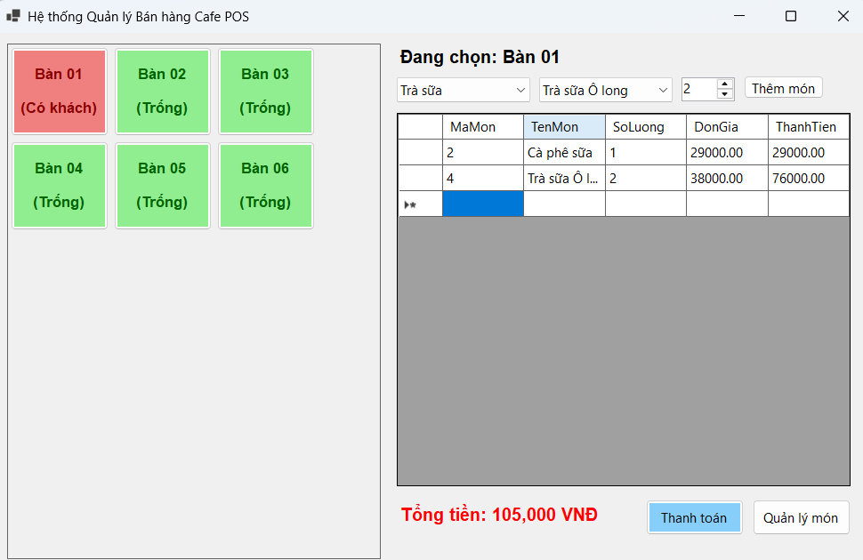
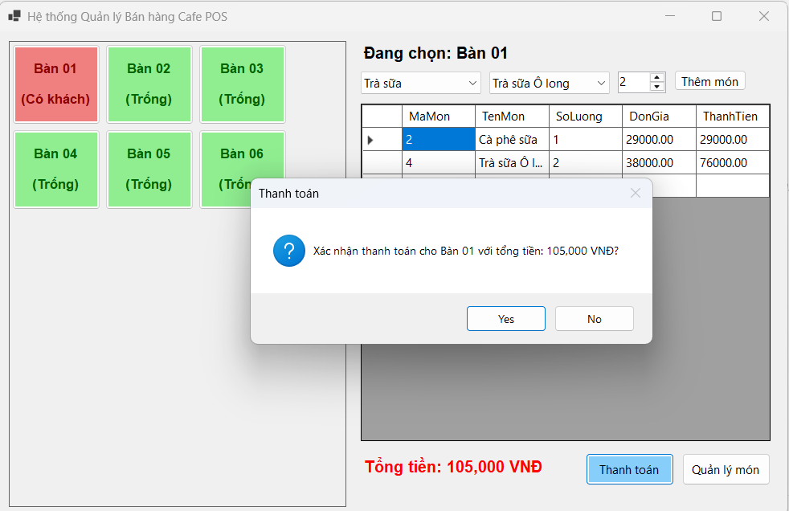

# HỆ THỐNG QUẢN LÝ QUÁN CAFE (POS CAFE SYSTEM)

## MỤC 1: THÔNG TIN SINH VIÊN
- **Họ và tên sinh viên:** Nguyễn Văn Lộc
- **Mã sinh viên:** 24810320093
- **Tên Đề tài / Bài tập:** Hệ thống Quản lý Bán hàng POS Cafe (WinForms - Mô hình 3 lớp)

---

## MỤC 2: HƯỚNG DẪN CÀI ĐẶT & CHẠY DỰ ÁN

### Các bước cài đặt:

1. **Khởi tạo Cơ sở dữ liệu:**
   - Mở **SQL Server Management Studio (SSMS)** (hoặc công cụ MSSQL trong VS Code).
   - Kết nối tới SQL Server Local Instance (ví dụ: `.\SQLEXPRESS`).
   - Mở file `Database/ScriptDB.sql` và thực thi (Execute) để tạo CSDL `CafePOSDB` cùng các bảng và dữ liệu mẫu.

2. **Mở dự án:**
   - Mở file `.sln` bằng **Visual Studio 2022** hoặc mở thư mục `CafePOS` bằng **VS Code**.

3. **Cấu hình chuỗi kết nối (ConnectionString):**
   - Mở file `DAL/DatabaseHelper.cs` và cập nhật lại chuỗi kết nối cho phù hợp với máy cá nhân nếu cần:
     ```csharp
     private static string strConn = @"Data Source=.\SQLEXPRESS;Initial Catalog=CafePOSDB;Integrated Security=True;TrustServerCertificate=True";
     ```

4. **Build & Run dự án:**
   - Nếu dùng **Visual Studio 2022**: Nhấn phím **F5** để Build và Chạy dự án.
   - Nếu dùng **VS Code**: Mở Terminal và gõ lệnh:
     ```bash
     dotnet clean
     dotnet run
     ```
     *(Trường hợp bị Windows Security / Smart App Control chặn file `.exe`, chạy thông qua tệp `.dll` bằng lệnh: `dotnet .\bin\Debug\net8.0-windows\CafePOS.dll`)*

---

## MỤC 3: HÌNH ẢNH KẾT QUẢ CÁC MÀN HÌNH CHỨC NĂNG

1. **Màn hình Chính / Tổng quan:**
   

2. **Màn hình Quản lý Danh mục / Thêm Sửa Xóa (CRUD):**
   

3. **Màn hình Thực thi Nghiệp vụ chính (Lập phiếu / Gọi món / Check-in):**
   

4. **Màn hình Báo cáo - Thống kê:**
   

5. **Minh họa chống SQL Injection hoặc Báo lỗi Giao dịch (Rollback):**
   