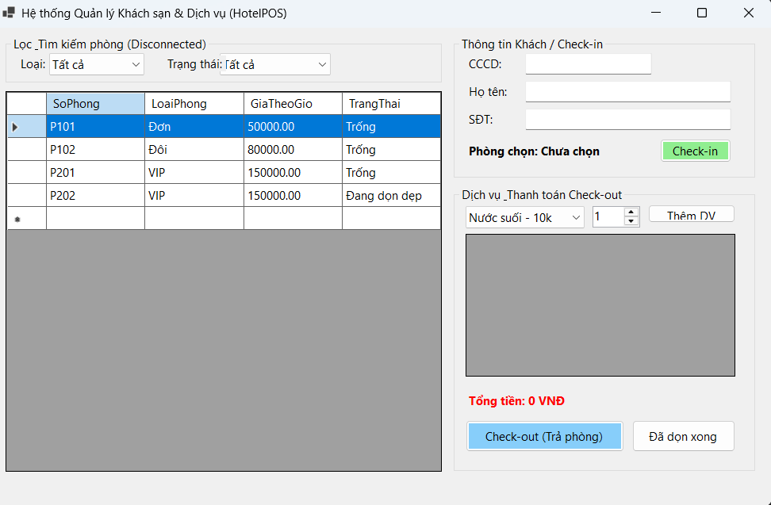
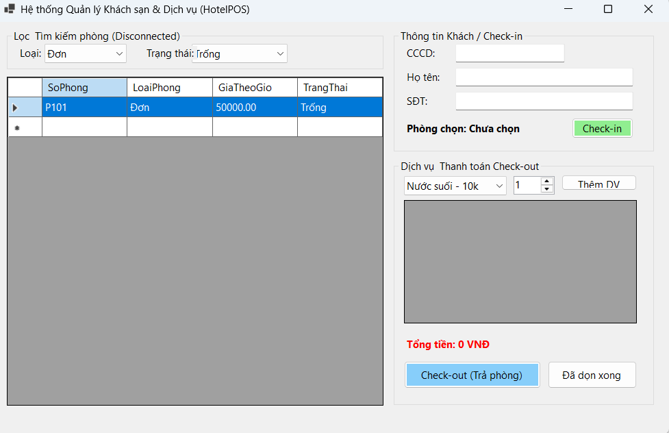
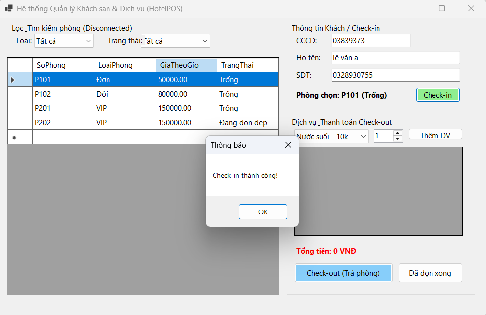
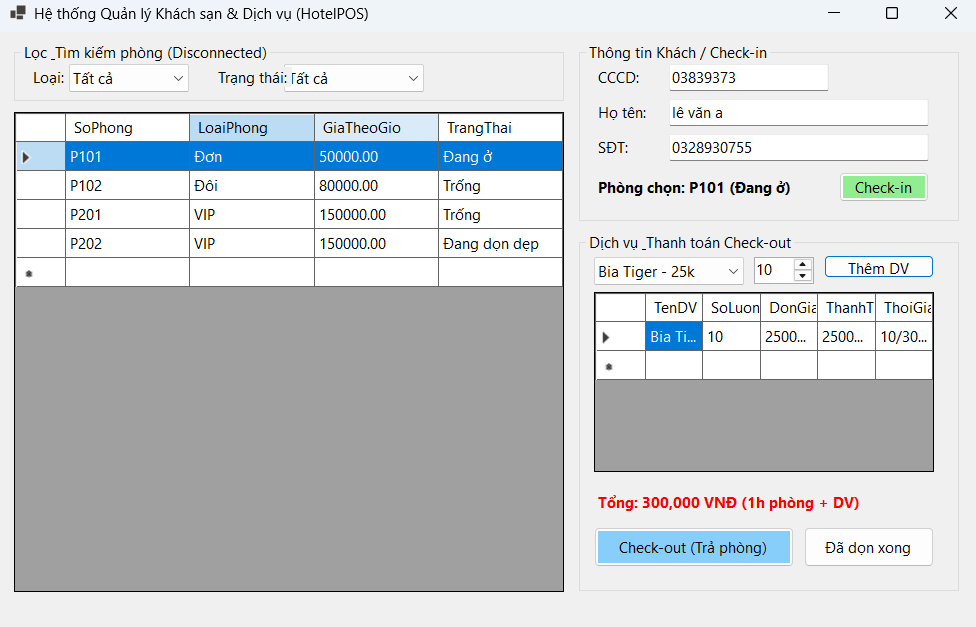
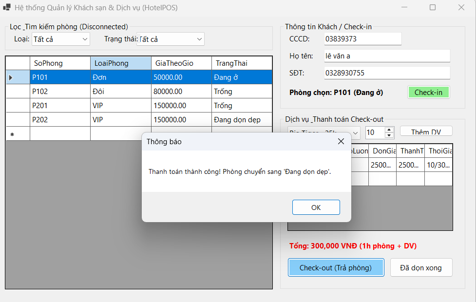

# HỆ THỐNG QUẢN LÝ KHÁCH SẠN & DỊCH VỤ (HOTELPOS SYSTEM)

## MỤC 1: THÔNG TIN SINH VIÊN
- **Họ và tên sinh viên:** Nguyễn Văn Lộc
- **Mã sinh viên:** 24810320093
- **Tên Đề tài / Bài tập:** Bài tập 5.4 - Hệ thống Quản lý Tiện ích Dịch vụ & Khách sạn (HotelPOS)

---

## MỤC 2: HƯỚNG DẪN CÀI ĐẶT & CHẠY DỰ ÁN
### Các bước cài đặt:
1. Mở SQL Server Management Studio (SSMS) hoặc Terminal, chạy file `Database/ScriptDB.sql` để khởi tạo CSDL `HotelDB` và dữ liệu mẫu.
2. Mở dự án trong VS Code / Visual Studio 2022.
3. Mở file `DAL/DatabaseHelper.cs`, kiểm tra và sửa lại chuỗi kết nối `strConn` cho phù hợp với máy cá nhân.
4. Build & Run dự án bằng lệnh `dotnet run` (hoặc `dotnet .\bin\Debug\net8.0-windows\HotelPOS.dll`).

---

## MỤC 3: HÌNH ẢNH KẾT QUẢ CÁC MÀN HÌNH CHỨC NĂNG

1. **Màn hình Chính / Tổng quan:**
   

2. **Màn hình Quản lý Danh mục / Lọc ngắt kết nối (DataView):**
   

3. **Màn hình Thực thi Nghiệp vụ chính (Check-in / Tra cứu CCCD / Gọi dịch vụ):**
   

4. **Màn hình Báo cáo - Thống kê / Tính tiền Check-out:**
   

5. **Minh họa Báo lỗi Giao dịch (SqlTransaction Rollback) & Cảnh báo:**
   