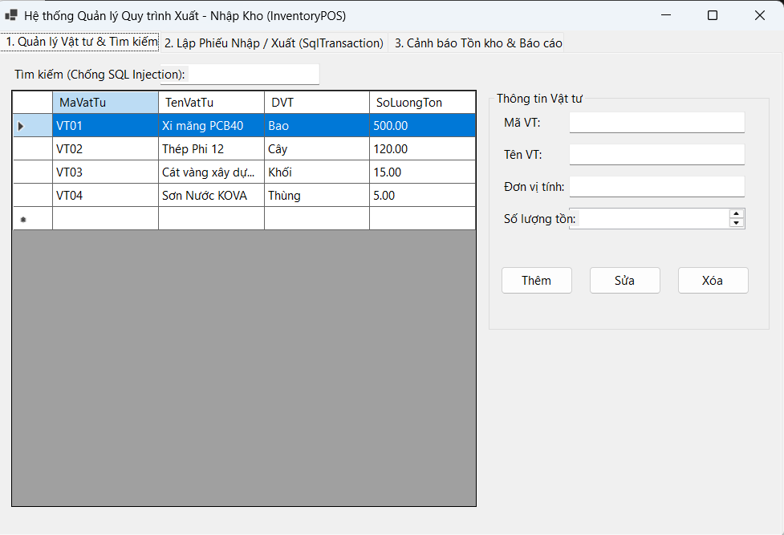
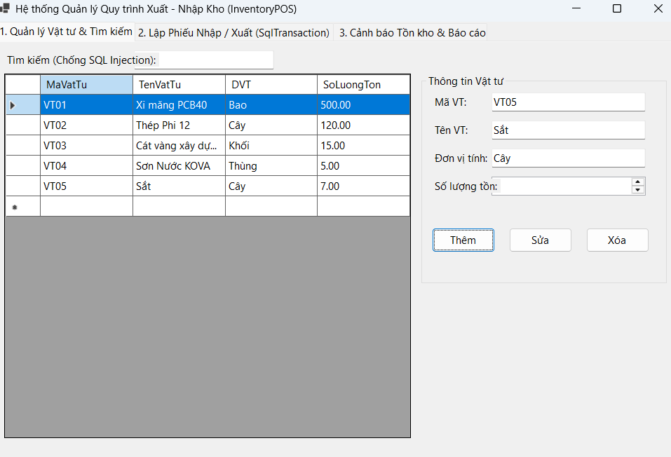
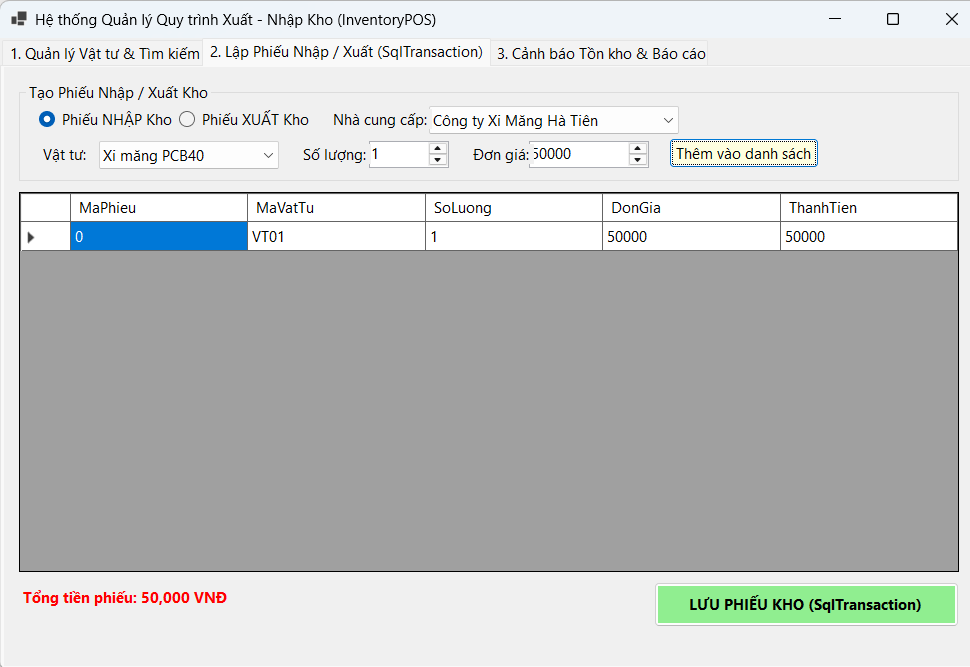
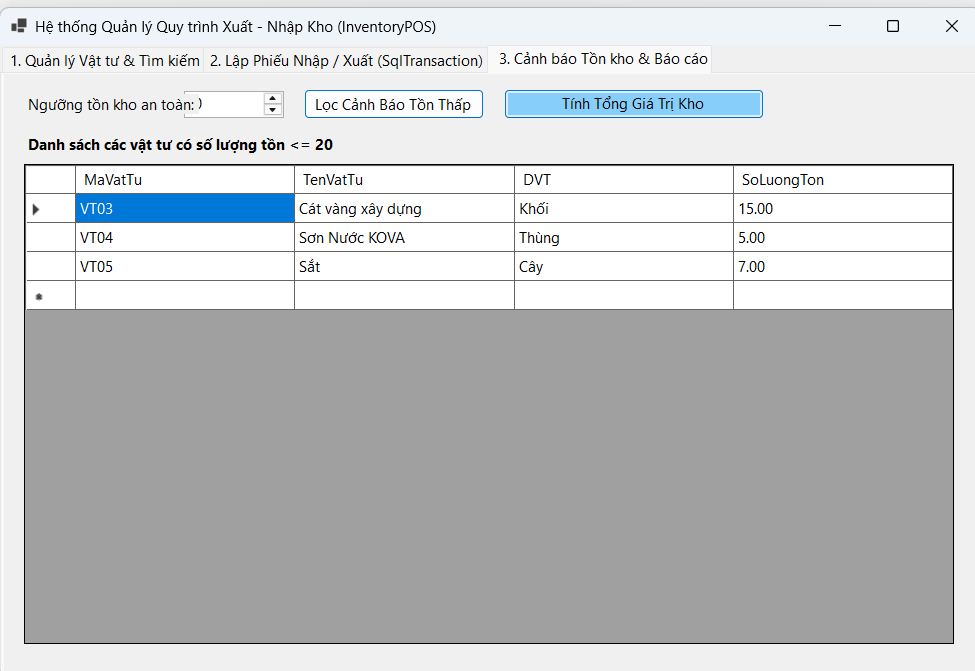
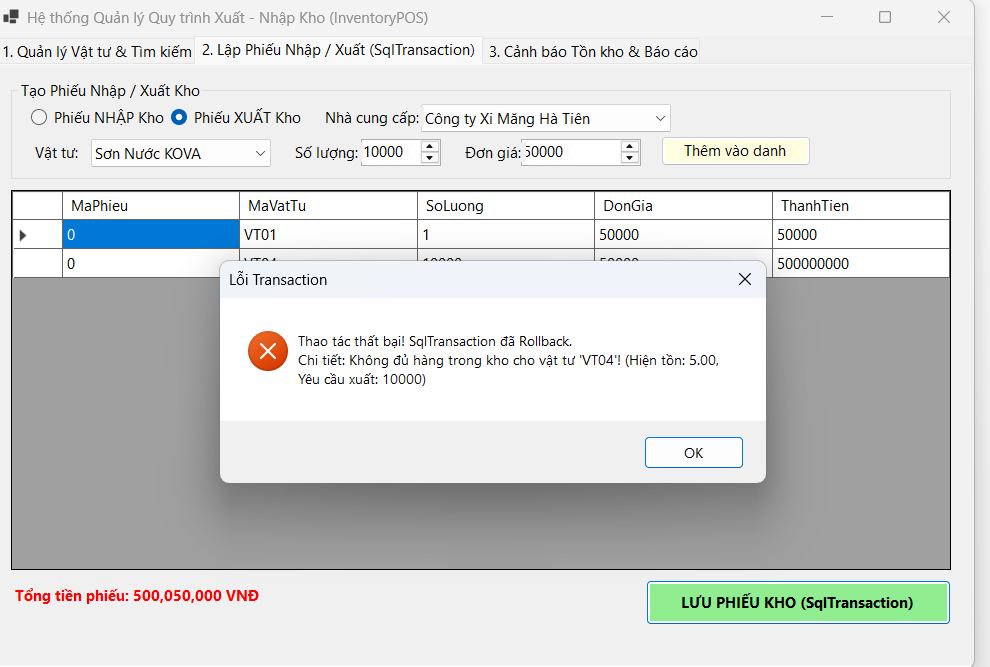

# HỆ THỐNG QUẢN LÝ QUY TRÌNH XUẤT - NHẬP KHO (INVENTORYPOS)

## MỤC 1: THÔNG TIN SINH VIÊN
- **Họ và tên sinh viên:** Nguyễn Văn Lộc
- **Mã sinh viên:** 24810320093
- **Tên Đề tài / Bài tập:** Bài tập 5.5 - Hệ thống Quản lý Quy trình Xuất - Nhập Kho Nguyên Vật Liệu (InventoryPOS)

---

## MỤC 2: HƯỚNG DẪN CÀI ĐẶT & CHẠY DỰ ÁN
### Các bước cài đặt:
1. Mở SQL Server Management Studio (SSMS) hoặc Terminal, chạy file `Database/ScriptDB.sql` để khởi tạo CSDL `InventoryDB` và dữ liệu mẫu.
2. Mở giải pháp trong VS Code / Visual Studio 2022.
3. Mở file `DAL/DatabaseHelper.cs`, kiểm tra và sửa lại chuỗi kết nối `strConn` cho phù hợp với máy cá nhân.
4. Build & Run dự án bằng lệnh `dotnet run` (hoặc `dotnet .\bin\Debug\net8.0-windows\InventoryPOS.dll`).

---

## MỤC 3: HÌNH ẢNH KẾT QUẢ CÁC MÀN HÌNH CHỨC NĂNG

1. **Màn hình Chính / Tổng quan:**
   

2. **Màn hình Quản lý Danh mục / Thêm Sửa Xóa (CRUD):**
   

3. **Màn hình Thực thi Nghiệp vụ chính (Lập Phiếu Nhập / Xuất Kho với SqlTransaction):**
   

4. **Màn hình Báo cáo - Thống kê (Tính tổng giá trị tồn kho bằng ExecuteScalar):**
   

5. **Minh họa Chống SQL Injection (SqlParameter) & Báo lỗi Rollback Transaction khi xuất quá tồn kho:**
   